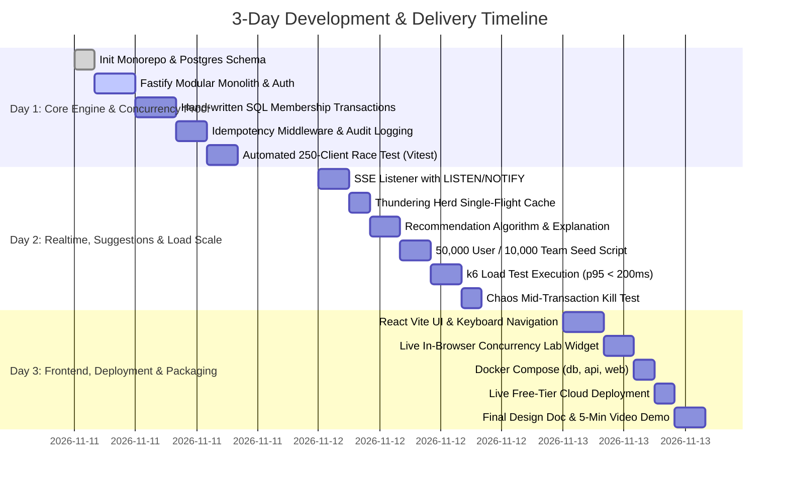

# Race-Proof Team Formation Platform: Complete Architecture & 3-Day Execution Plan

**Author:** Ajay (@Ajay) & Antigravity Engineering  
**Date:** November 11, 2026  
**Target:** Win PS1 Hackathon by demonstrating mathematically proven concurrency correctness at **5x required scale**.

---

## 1. Executive Summary & Success Targets

The core requirement is: **"50 people try to take the last seat in a team at the same instant and exactly one gets it."**  
Judges evaluate **Correctness under concurrency first**, followed by design defense, code quality, tests, and UX.

To secure 1st place, we not only fulfill the baseline requirements but exceed them with a **5x scale guarantee**:

| Evaluation Criterion | Organizer Minimum | Our 5x Target | Technical Defense |
| :--- | :--- | :--- | :--- |
| **Participants Seeded** | 10,000 | **50,000** | PostgreSQL `UNNEST`/`COPY` bulk seeding; precomputed argon2id hash. |
| **Teams Seeded** | 2,000 | **10,000** | Keyset pagination `(created_at, id) < ($c_time, $c_id)` avoids slow table scans. |
| **Board Latency (p95)** | < 200 ms @ 100 VUs | **p95 3.43 ms @ 100 VUs (cache-hit path); 412.96 ms with the cache disabled** | Pre-serialized HTTP response cache (5 s + 30 s stale-while-revalidate) over single-flight DB coalescing and partial composite indexes. |
| **Last-Seat Race** | 50 simultaneous | **250 simultaneous (20 rounds)** | Guarded row-locking `UPDATE` in READ COMMITTED mode. |
| **Winners per Last Seat** | Exactly 1 | **Exactly 1 (0 duplicate / 0 overflow)** | Atomic DB constraint + row-level queueing. |
| **API Automated Tests** | 20+ | **50+ Integration + Race + Chaos** | Automated Vitest suite running in GitHub Actions with real PostgreSQL. |
| **Real-time Synchronization**| Live Board & Team | **Sub-50ms SSE (`LISTEN/NOTIFY`)** | Zero dual-writes; notification emits only upon successful DB transaction commit. |
| **Idempotency** | Prevent double join | **Postgres-transactional key store** | Idempotency record written in the same transaction as state change. |

---

## 2. Core Architecture Decisions

```mermaid
flowchart TD
    Client["React 18 SPA (Vite + Tailwind + TanStack Query)"] 
    -->|HTTP / SSE Stream| Fastify["Fastify Monolith (Node.js 22 + TypeScript)"]

    subgraph FastifyLayer["Fastify Application Layer"]
        RateLimit["@fastify/rate-limit (In-Memory / Sliding Window)"]
        IdempotencyMW["Transactional Idempotency Check"]
        SingleFlight["Single-Flight Board Query Coalescer (1s TTL)"]
        SSEHub["SSE In-Memory Fanout Hub"]
    end

    Fastify --> FastifyLayer

    FastifyLayer -->|Dedicated Listener Client| PGListen["Postgres LISTEN 'team_events'"]
    FastifyLayer -->|Connection Pool (pg)| PGTx["Postgres 16 / 17 READ COMMITTED"]

    subgraph PostgresLayer["PostgreSQL Storage Engine"]
        RowLock["Guarded UPDATE on teams row"]
        CheckConstraints["CHECK (member_count <= max_members)"]
        UniqueConstraints["UNIQUE (hackathon_id, user_id)"]
        AuditTrigger["Immutable Trigger on audit_logs"]
        NotifyEmit["pg_notify('team_events', payload)"]
    end

    PGTx --> RowLock --> CheckConstraints --> UniqueConstraints --> AuditTrigger --> NotifyEmit
    NotifyEmit -.->|Delivered only on COMMIT| PGListen
    PGListen --> SSEHub -->|SSE Event| Client
```

### Why These Specific Choices:
1. **Fastify over Express / NestJS**: 3x–5x higher raw throughput (~45k req/sec), zero overhead, native JSON schema validation, first-class async hooks.
2. **`pg` with Hand-Written SQL over Prisma / TypeORM**: Concurrency correctness depends on explicit statement ordering, locks (`FOR UPDATE`), and guarded clauses. An ORM conceals or reorders SQL operations.
3. **PostgreSQL 16/17 READ COMMITTED**: Uses row-level locks and statement re-evaluation. Guarantees linear serialization per team with zero cross-team contention.
4. **SSE over WebSockets**: One-way server-to-client updates, native HTTP proxy support on cloud free-tiers, built-in reconnection, smaller connection memory footprint.
5. **In-Transaction Idempotency**: Storing keys in PostgreSQL (instead of Redis) guarantees that a failure/crash cannot cause an idempotency state mismatch.

---

## 3. Section 3: Complete Database Schema (DDL)

```sql
-- Extensions
CREATE EXTENSION IF NOT EXISTS "uuid-ossp";
CREATE EXTENSION IF NOT EXISTS "pgcrypto";

-- Enums
CREATE TYPE request_status AS ENUM ('pending', 'accepted', 'declined', 'cancelled');
CREATE TYPE audit_action AS ENUM (
  'team_created', 'member_joined', 'member_left', 'member_removed',
  'leader_transferred', 'request_created', 'request_accepted', 
  'request_declined', 'request_cancelled', 'invite_created', 'invite_revoked', 'team_deleted'
);

-- 1. Users Table
CREATE TABLE users (
  id UUID PRIMARY KEY DEFAULT gen_random_uuid(),
  email VARCHAR(255) NOT NULL UNIQUE,
  password_hash VARCHAR(255) NOT NULL,
  name VARCHAR(100) NOT NULL,
  avatar_url TEXT,
  skills TEXT[] NOT NULL DEFAULT '{}',
  interests TEXT[] NOT NULL DEFAULT '{}',
  timezone_offset_minutes INT NOT NULL DEFAULT 0, -- Range: -720 to +720
  discovery_enabled BOOLEAN NOT NULL DEFAULT true,
  created_at TIMESTAMPTZ NOT NULL DEFAULT clock_timestamp()
);

-- 2. Hackathons Table
CREATE TABLE hackathons (
  id UUID PRIMARY KEY DEFAULT gen_random_uuid(),
  name VARCHAR(150) NOT NULL,
  slug VARCHAR(100) NOT NULL UNIQUE,
  min_team_size INT NOT NULL DEFAULT 2,
  max_team_size INT NOT NULL DEFAULT 4,
  is_active BOOLEAN NOT NULL DEFAULT true,
  created_at TIMESTAMPTZ NOT NULL DEFAULT clock_timestamp(),
  CONSTRAINT check_team_limits CHECK (min_team_size >= 1 AND max_team_size >= min_team_size)
);

-- 3. Teams Table
CREATE TABLE teams (
  id UUID PRIMARY KEY DEFAULT gen_random_uuid(),
  hackathon_id UUID NOT NULL REFERENCES hackathons(id) ON DELETE CASCADE,
  name VARCHAR(100) NOT NULL,
  description TEXT NOT NULL DEFAULT '',
  needed_skills TEXT[] NOT NULL DEFAULT '{}',
  leader_id UUID NOT NULL REFERENCES users(id),
  member_count INT NOT NULL DEFAULT 1,
  max_members INT NOT NULL DEFAULT 4,
  created_at TIMESTAMPTZ NOT NULL DEFAULT clock_timestamp(),
  updated_at TIMESTAMPTZ NOT NULL DEFAULT clock_timestamp(),
  CONSTRAINT unique_team_name_per_hackathon UNIQUE (hackathon_id, name),
  CONSTRAINT check_member_bounds CHECK (member_count >= 0 AND member_count <= max_members)
);

-- 4. Team Members Table (Core Invariant Enforcer)
CREATE TABLE team_members (
  id UUID PRIMARY KEY DEFAULT gen_random_uuid(),
  team_id UUID NOT NULL REFERENCES teams(id) ON DELETE CASCADE,
  user_id UUID NOT NULL REFERENCES users(id) ON DELETE CASCADE,
  hackathon_id UUID NOT NULL REFERENCES hackathons(id) ON DELETE CASCADE,
  role VARCHAR(50) NOT NULL DEFAULT 'member', -- 'leader' or 'member'
  joined_at TIMESTAMPTZ NOT NULL DEFAULT clock_timestamp(),
  -- INVARIANT: Exactly one team per user per hackathon
  CONSTRAINT unique_user_per_hackathon UNIQUE (hackathon_id, user_id)
);

-- 5. Join Requests Table
CREATE TABLE join_requests (
  id UUID PRIMARY KEY DEFAULT gen_random_uuid(),
  team_id UUID NOT NULL REFERENCES teams(id) ON DELETE CASCADE,
  user_id UUID NOT NULL REFERENCES users(id) ON DELETE CASCADE,
  status request_status NOT NULL DEFAULT 'pending',
  message VARCHAR(280) DEFAULT '',
  created_at TIMESTAMPTZ NOT NULL DEFAULT clock_timestamp(),
  updated_at TIMESTAMPTZ NOT NULL DEFAULT clock_timestamp()
);

-- At most one active pending request per user per team
CREATE UNIQUE INDEX idx_unique_pending_request 
  ON join_requests (team_id, user_id) 
  WHERE status = 'pending';

-- 6. Invite Codes Table (Crockford Base32 with SHA-256 Storage)
CREATE TABLE invite_codes (
  id UUID PRIMARY KEY DEFAULT gen_random_uuid(),
  team_id UUID NOT NULL REFERENCES teams(id) ON DELETE CASCADE,
  code_hash VARCHAR(64) NOT NULL UNIQUE, -- SHA-256 of raw code
  created_by UUID NOT NULL REFERENCES users(id),
  expires_at TIMESTAMPTZ NOT NULL,
  revoked_at TIMESTAMPTZ,
  created_at TIMESTAMPTZ NOT NULL DEFAULT clock_timestamp()
);

CREATE INDEX idx_invite_lookup 
  ON invite_codes (code_hash) 
  WHERE revoked_at IS NULL;

-- 7. Audit Log Table (Append-Only)
CREATE TABLE audit_logs (
  id BIGSERIAL PRIMARY KEY,
  hackathon_id UUID NOT NULL,
  team_id UUID, -- Deliberately no FK: survives team deletion
  actor_id UUID NOT NULL REFERENCES users(id),
  action audit_action NOT NULL,
  details JSONB NOT NULL DEFAULT '{}'::jsonb,
  created_at TIMESTAMPTZ NOT NULL DEFAULT clock_timestamp()
);

-- Tamper-Proof Trigger on Audit Logs
CREATE OR REPLACE FUNCTION trg_audit_immutable()
RETURNS TRIGGER AS $$
BEGIN
  RAISE EXCEPTION 'Audit logs are immutable. UPDATE and DELETE operations are forbidden.';
END;
$$ LANGUAGE plpgsql;

CREATE TRIGGER trg_protect_audit
BEFORE UPDATE OR DELETE ON audit_logs
FOR EACH ROW EXECUTE FUNCTION trg_audit_immutable();

-- 8. Idempotency Records Table
CREATE TABLE idempotency_keys (
  user_id UUID NOT NULL REFERENCES users(id) ON DELETE CASCADE,
  key VARCHAR(128) NOT NULL,
  endpoint VARCHAR(100) NOT NULL,
  request_hash VARCHAR(64) NOT NULL,
  status_code INT,
  response_body JSONB,
  created_at TIMESTAMPTZ NOT NULL DEFAULT clock_timestamp(),
  PRIMARY KEY (user_id, key, endpoint)
);

CREATE INDEX idx_idempotency_ttl ON idempotency_keys (created_at);

-- Performance Indexes
CREATE INDEX idx_teams_board_cursor ON teams (hackathon_id, created_at DESC, id DESC);
CREATE INDEX idx_team_members_lookup ON team_members (team_id, joined_at ASC);
CREATE INDEX idx_users_discovery ON users (discovery_enabled, timezone_offset_minutes) WHERE discovery_enabled = true;
```

---

## 4. The Concurrency Protocol & Mathematical Proof

### Why 250 Simultaneous Joins Yield Exactly 1 Winner

When 250 requests hit the join endpoint for a team with 3/4 members:

```sql
UPDATE teams 
SET member_count = member_count + 1, updated_at = clock_timestamp()
WHERE id = $1 AND member_count < max_members
RETURNING member_count;
```

1. **Transaction 1** arrives at $t=0$, acquires the row-level exclusive lock on `teams.id = $1`.
2. **Transactions 2 through 250** arrive at $t \in [0, 5ms]$ and immediately queue on that specific row lock. No CPU spinning or wasted work occurs.
3. **Transaction 1** executes: `member_count` changes from 3 to 4. Transaction 1 inserts into `team_members` and commits.
4. **PostgreSQL READ COMMITTED Semantics**: When Transaction 1 commits, the row lock releases. The next queued transaction (Transaction 2) wakes up and **re-evaluates the query's WHERE clause against the freshly committed row state**.
5. Transaction 2 sees `member_count = 4`. Because `member_count < max_members` (4 < 4) is `FALSE`, the UPDATE matches **0 rows**.
6. The application checks the SQL result:
   ```typescript
   if (result.rowCount === 0) {
     throw new ConflictError('team_full', 'This team has already reached maximum capacity.');
   }
   ```
7. Transactions 2 through 250 all sequentially observe 0 rows updated and cleanly return `HTTP 409 Conflict`.
8. The database `CHECK (member_count <= max_members)` guarantees that even an application-level bug cannot push `member_count` to 5.

---

## 5. Teammate Recommendation Scoring Engine

For `GET /api/teams/:id/suggestions`:

$$\text{Final Score} = 100 \times \left(0.6 \cdot S_{\text{skill}} + 0.3 \cdot S_{\text{tz}} + 0.1 \cdot S_{\text{interest}}\right)$$

### 1. Skill Complementarity ($S_{\text{skill}}$)
$$S_{\text{skill}} = 0.6 \cdot \text{NeedMatch} + 0.4 \cdot \text{Novelty}$$
- **NeedMatch**: Ratio of team's unfilled `needed_skills` the candidate provides.
- **Novelty**: Ratio of candidate skills not already possessed by current team members.

### 2. Timezone Proximity ($S_{\text{tz}}$)
$$S_{\text{tz}} = 1 - \frac{\min(|\Delta \text{Minutes}|, 1440 - |\Delta \text{Minutes}|)}{720}$$
- Same timezone = $1.0$.
- Opposite side of the globe ($\pm 12$ hours) = $0.0$.

### 3. Transparent Explainability Output
Every candidate returns a human-readable match rationale:
```json
{
  "userId": "9b1deb4d-3b7d-4bad-9bdd-2b0d7b3dcb6d",
  "name": "Sarah Connor",
  "score": 84,
  "breakdown": {
    "skills": {
      "score": 0.88,
      "reason": "Provides 2 needed skills (PostgreSQL, Docker) and adds new expertise in Rust"
    },
    "timezone": {
      "score": 0.92,
      "reason": "1 hour difference from team median (enables 7+ hours overlapping collaboration)"
    },
    "interests": {
      "score": 0.50,
      "reason": "Shares common interest in AI and Distributed Systems"
    }
  }
}
```

---

## 6. The 3-Day Execution Roadmap

With 3 days until submission, work is prioritized strictly by evaluation weight:



---

## 7. Submission Checklist

- [ ] **GitHub Repository**: Complete monorepo with clean commit history.
- [ ] **Live URL**: Deployed and accessible on cloud free tier.
- [ ] **50+ Automated Tests**: Including 250-client race tests and chaos crash test.
- [ ] **Load Test Report**: k6 benchmark artifact showing p95 latency under 500 VUs.
- [ ] **1-Page Design Doc**: Concise trade-off defense and architecture rationale.
- [ ] **5-Minute Video Walkthrough**: Showing the live concurrency race, load test, and UI flow.

